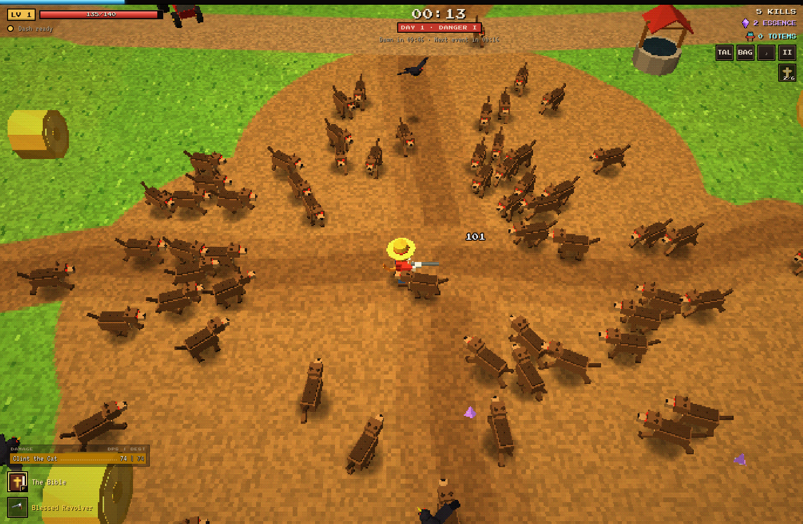
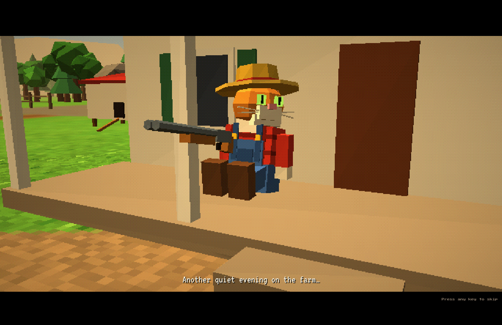
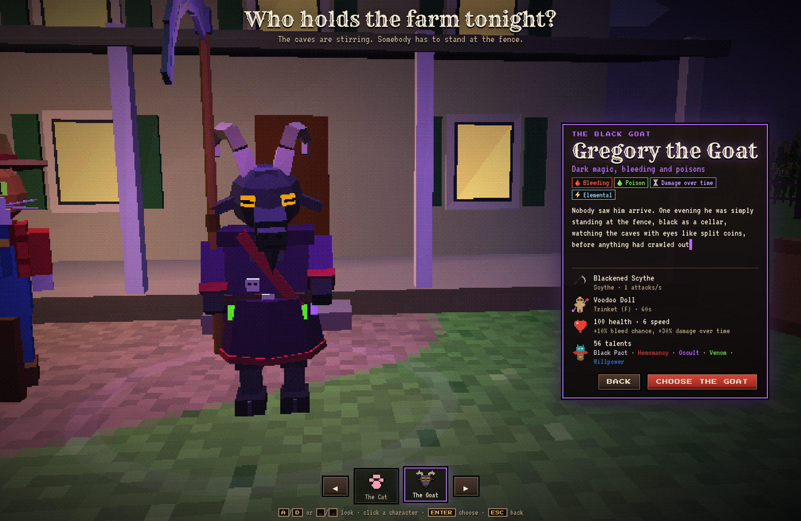
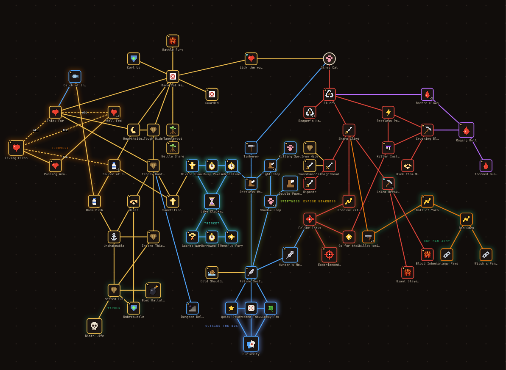

## Barnyard Reaper v0.2.2

### Roguelike game with endless monsters

- talent trees
- additional eldritch powers
- upgrades every level
- trinkets
- various weapons for different builds
- item upgrade system
- dungeons

## Screenshots:



> First 13 seconds of the game



> Cutscenes



> Character selection for different playstyles



> Talent tree (work in progress)

## Launching

Starts the game and its tools (one local server: tools/serve.py) in the background.

```bash
./barnyard
```

Tools for simulation / talent editor

```bash
localhost:8000/tools/talents
localhost:8000/tools/balance
```
